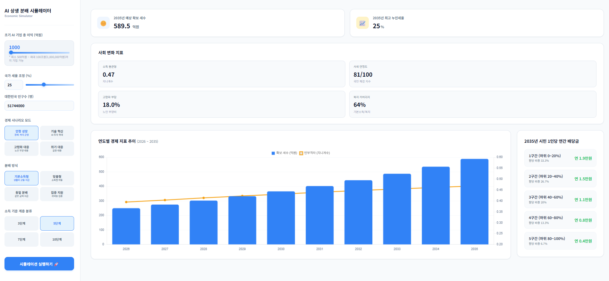

# AI 상생분배 시뮬레이터

## 프로젝트 개요
 AI로 얻은 수익을 국민에게 재분배 하는 시스템 시뮬레이터
  1. 기업 총 이익
  2. 세율
  3. 인구 수
  4. 경제 방향
  5. 분배 방식
  6. 계층 단계

## 기술 스택
 웹 프레임워크: python Flask
 웹 프론트엔드: HTML JS CSS

## 파일 트리
```
project
├─static
│  ├─css/style.css
│  └─js/main.js
├─templates/index.html
└─app.py
```

## 시연

